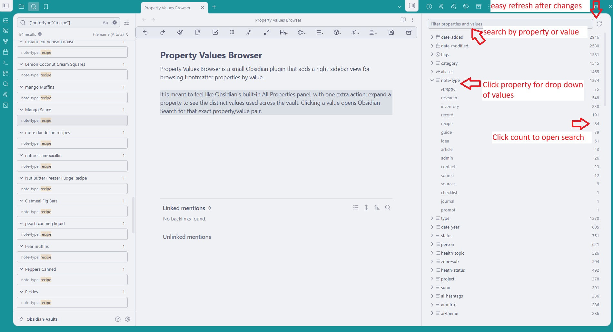

# Property Values Browser

A right-sidebar view for browsing frontmatter properties by value. It feels like Obsidian's All Properties panel, with one extra step: expand a property to see the distinct values used across the vault.

## Features

- Shows property names and values with counts. List values are counted separately, whether YAML is inline or multiline. Blank or null values show as `(empty)`.
- Filters names and values from the top input. A refresh button rebuilds the list.
- Clicks a property count to search for every note with that property. Clicks a value to search for that exact property/value pair. Search opens in the sidebar with the query set.
- Right-clicks a property for **Rename property** or **Delete property**.
- Right-clicks a value for **Rename value** or **Delete value**.
- Rename asks for confirmation and shows how many notes will change. If the new property name or value already exists, it merges them and de-duplicates lists.
- Opens from the ribbon or the command palette.

## Install

Download these three files from the [latest release](https://github.com/SoulBits-Vibe/property-values-browser/releases/latest):

main.js
manifest.json
styles.css

Put them in `<your vault>/.obsidian/plugins/property-values-browser/`.

Then reload Obsidian and enable **Property Values Browser** in Community plugins.

## Limitations

- Rename and delete actions update frontmatter in matching notes after confirmation, but the plugin does not provide its own undo history.
- The list is based on Obsidian's metadata cache, so very recent file changes may need a refresh.
